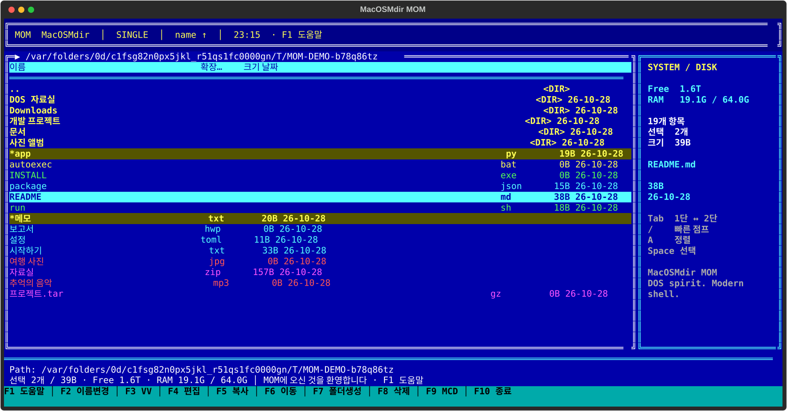

# MacOSMdir MOM

**MOM**은 Mdir III에서 영감을 받아 만든 한국어 터미널 파일 관리자입니다. VGA 파란 화면, 이중선 테두리, 확장자별 색상, 1단·2단 목록을 현대적인 Python/Textual로 구현했습니다. 공식 Mdir의 소스나 자산을 사용하지 않은 독립 구현입니다. 참고 영상의 원본 동작을 모두 검증한 복각은 아닙니다.



## 바로 실행

Python **3.11 이상**이 필요합니다. macOS 기본 `/usr/bin/python3`가 3.9라면 별도로 설치한 Python 또는 uv를 사용하세요.

```sh
cd /Users/honeymon/git-repos/codex-mom
uv venv --python 3.12
source .venv/bin/activate
uv pip install -e '.[test]'
m2
```

uv 없이 설치할 때:

```sh
python3.11 -m venv .venv
source .venv/bin/activate
python -m pip install -r requirements.txt
python -m pip install -e .
m2
```

이 작업 환경에는 `.venv`와 실행 명령을 이미 설치했습니다. 현재 프로젝트에서 `source .venv/bin/activate` 후 `m2`를 실행하면 됩니다.

다른 실행 방법:

```sh
python -m mom ~/Downloads
m2 ~/Downloads --print-last-dir
m2 --version
m2 --help
```

Windows PowerShell:

```powershell
py -3.12 -m venv .venv
.\.venv\Scripts\Activate.ps1
python -m pip install -e ".[test]"
m2
```

권장 터미널 크기는 **120×32 이상**, 최소 크기는 **60×18**입니다. 한글과 이모지를 지원하는 고정폭 글꼴을 사용하세요. `NO_COLOR`가 설정되어 있으면 Textual이 색상을 제거합니다. 파란 화면이 필요하면 `unset NO_COLOR` 후 실행하세요.

## `m2`로 실행

패키지 설치 시 `m2` console script가 생성됩니다. 가상환경을 활성화하거나 해당 실행 파일 경로를 PATH에 넣으면 됩니다. 프로젝트 밖에서도 사용하려면 `pipx install /프로젝트/경로` 또는 `uv tool install /프로젝트/경로`로 설치할 수도 있습니다.

별도 alias를 선호한다면 `~/.zshrc` 또는 `~/.bashrc`에 추가하세요.

```sh
alias m2='/Users/honeymon/git-repos/codex-mom/.venv/bin/python -m mom'
```

alias 방식은 종료 후 부모 셸의 디렉터리를 바꾸지 않습니다. 아래 함수 방식과 alias 방식 중 하나를 선택하세요.

### 종료한 디렉터리를 셸에도 유지

Python 자식 프로세스는 부모 셸의 작업 디렉터리를 직접 바꿀 수 없습니다. MOM이 마지막 실제 경로를 임시 파일에 기록하고, 셸 함수가 그 경로로 `cd`합니다. 압축 안에서 종료하면 압축 파일이 위치한 실제 디렉터리로 이동합니다.

bash / zsh에서, 설치된 `m2`가 PATH에 있는 경우:

```sh
unalias m2 2>/dev/null || true
source /Users/honeymon/git-repos/codex-mom/scripts/mom-shell.sh
m2
```

매번 가상환경을 활성화하지 않고 현재 프로젝트의 설치를 사용하려면 다음 내용을 `~/.zshrc`에 직접 추가하세요.

```sh
unalias m2 2>/dev/null || true
export PATH="/Users/honeymon/git-repos/codex-mom/.venv/bin:$PATH"
source /Users/honeymon/git-repos/codex-mom/scripts/mom-shell.sh
```

함수 원문은 [scripts/mom-shell.sh](scripts/mom-shell.sh)에 있습니다. `command m2`로 함수 재귀 호출을 피하고, 공백·한글·개행이 포함된 경로를 보존합니다. 셸 설정 파일은 앱이 자동 수정하지 않습니다.

PowerShell에서는 설치된 `m2.exe`가 PATH에 있는 상태에서 다음 파일을 dot-source하세요. 지속하려면 `$PROFILE`에 추가합니다.

```powershell
. 'C:\프로젝트\codex-mom\scripts\mom-shell.ps1'
m2
```

실행 파일 위치는 `Get-Command m2 -CommandType Application`으로 찾으므로 함수가 자기 자신을 호출하지 않습니다. 정상 종료하고 기록된 경로가 실제 폴더일 때만 이동합니다.

## 사용법

| 키 | 동작 |
|---|---|
| ↑ / ↓ | 이전 / 다음 항목 |
| ← / → | 이전 / 다음 페이지 |
| PgUp / PgDn, Home / End | 페이지 이동, 처음 / 끝 |
| Enter | 디렉터리·지원 압축 열기, 텍스트 보기, 프로그램 실행 확인 |
| Backspace | 상위 디렉터리 |
| Space / Insert | `*` 선택 토글 후 다음 항목 |
| Tab | 1단 ↔ 2단 패널 |
| Ctrl+← / Ctrl+→ | 듀얼 패널의 왼쪽 / 오른쪽 활성화 |
| C / F5 | 복사, 압축 내부에서는 추출 |
| M / F6 | 이동 |
| F2 | 현재 항목 이름 변경 |
| D / Delete / F8 | 확인 후 **영구 삭제** |
| K / F7 | 폴더 생성 |
| V / F3 | VV 텍스트 뷰어 |
| F4 | 외부 편집기 |
| A | 정렬 항목 / 역순 선택 |
| T / F9 | MCD 디렉터리 트리 |
| /, Alt+문자 | 접두사 / 첫 글자 점프 |
| Ctrl+R | 파일 목록 새로고침 |
| F1 | 도움말 |
| Q / F10 | 종료 |
| Esc | 모달 닫기 / 압축 탐색 종료 / 기본 화면 종료 |

대소문자 모두 명령으로 인식합니다. 입력창에서는 명령키가 일반 문자로 입력됩니다. macOS에서는 기능키에 Fn이 필요할 수 있습니다. Alt 조합을 가로채는 터미널에서는 `/`를 사용하세요.

처음에는 하나의 파일 목록을 표시하는 1단 화면으로 시작합니다. Tab을 누르면 좌우 2단 패널로 전환되고, 다시 누르면 1단으로 돌아옵니다. 각 패널의 파일 목록은 항상 1열입니다. 2단 패널은 각각 독립적인 경로·커서·선택을 유지합니다. 2단 화면에서 복사·이동의 기본 대상은 반대편 폴더입니다. 반대편이 압축을 탐색 중이면 그 압축이 위치한 실제 폴더를 기본 대상으로 사용합니다.

복사·이동은 선택 항목이 있으면 선택 집합에, 없으면 현재 항목에 적용합니다. 대상이 기존 폴더면 그 안에 넣고, 하나의 항목에 존재하지 않는 대상 경로를 지정하면 새 이름으로 복사·이동합니다. F2는 현재 항목 하나만 이름을 변경합니다. 정렬은 디렉터리 우선이며 `..`는 맨 위에 고정됩니다.

확장자 색상은 앱 번들·실행 확장자, 디렉터리, 스크립트, 압축, 문서, 미디어, 실행 권한, 일반 파일 순으로 판단합니다. 따라서 실행 권한이 있어도 `.py`는 노랑, `.zip`은 자홍입니다. 색상은 형식 분류이며 모든 형식을 열 수 있다는 뜻은 아닙니다.

선택 용량은 **디렉터리를 재귀 집계하지 않은 파일 크기 합계**입니다. 링크는 `@`로 표시하고 복사 시 링크 자체를 보존합니다. 파일 작업은 백그라운드에서 실행되며 Esc로 항목 사이에서 취소할 수 있습니다. 진행 중인 단일 항목은 완료까지 기다립니다. 다중 파일 작업은 부분 완료될 수 있으며 오류를 모아서 표시합니다.

덮어쓰기는 확인 후 수행하며 **기존 디렉터리는 전체 교체**합니다. 복사는 임시 위치에 완성한 뒤 교체합니다. 삭제는 휴지통을 거치지 않습니다.

### VV · 보라 뷰어

- UTF-8/BOM → CP949 순서의 휴리스틱 감지, 실패하면 대체 문자와 안내 표시
- 줄 번호, 인코딩, 위치 퍼센트, 방향키·페이지·처음·끝 이동
- `/` 검색, `n` 다음 결과, `N` 이전 결과, Esc/Q 닫기
- 왼쪽·오른쪽으로 가로 이동
- 최대 앞부분 8 MiB를 표시하며 초과 시 알림
- NUL이 포함된 바이너리는 열지 않음

F4는 `VISUAL`, `EDITOR` 순으로 사용하고, 없으면 Unix의 `vi`, Windows의 `notepad`를 실행합니다. 셸 파이프·리다이렉션이 아니라 실행 파일과 인자로 설정하세요. 외부 프로그램을 실행할 때 TUI를 반환하며, 종료 후 Enter로 복귀합니다.

### MCD · 트리

현재 실제 디렉터리에서 시작하는 지연 로딩 트리입니다. 화살표로 이동·확장·축소하고 Enter로 폴더에 진입합니다. ‘상위 경로’ 버튼으로 트리 기준점을 위로 옮길 수 있습니다. 심볼릭 링크 디렉터리는 순환 방지를 위해 제외합니다.

### 압축 탐색

ZIP, TAR, TAR.GZ/TGZ, TAR.BZ2/TBZ2, TAR.XZ를 읽기 전용 가상 폴더로 탐색합니다. Enter로 폴더 진입, VV로 텍스트 보기, C/F5로 실제 폴더에 추출합니다. 압축 추출 시 폴더는 병합하며, 충돌 파일만 확인 후 덮어씁니다. `..`로 내부 상위 경로를 탐색하고 압축 루트에서 상위로 이동하면 호스트 폴더로 돌아옵니다. Esc는 압축 탐색 전체를 닫습니다.

경로 이탈, 절대 경로, Windows 드라이브 경로, 링크·특수 파일은 제외합니다. 추출 대상 내부의 심볼릭 링크도 차단합니다. 압축 목차는 최대 10,000개, 해제 데이터는 총 512 MiB로 제한합니다. 실제 읽은 데이터 크기도 검사합니다. 신뢰할 수 없는 프로세스가 추출 경로를 동시에 바꾸는 환경을 위한 격리 도구는 아닙니다.

## 개발과 검증

```sh
python -m pip install -e '.[test]'
python -m pytest -q
```

테스트는 임시 디렉터리를 사용합니다. CJK·이모지 셀 폭, 정렬·선택, 복사·이동·이름 변경·삭제, UTF-8/CP949, ZIP/TAR 탐색·추출·안전 검사, 실제 Textual 키 입력과 60~180열 레이아웃을 검증합니다.

구조:

```text
mom/
  cli.py          실행 옵션과 마지막 경로 기록
  app.py          앱과 비동기 작업 조율
  widgets.py      1단/2단 파일 그리드
  screens.py      입력·확인, VV, MCD 화면
  filesystem.py   목록, 상태, 파일 작업, 텍스트 읽기
  archives.py     압축 VFS와 추출
  display.py      셀 폭, 안전한 표시, 색상
scripts/          bash/zsh 및 PowerShell 셸 래퍼
tests/            코어·TUI·셸 래퍼 테스트
docs/             실제 TUI 렌더링 SVG 캡처
```

화면 캡처: [1단](docs/mom-single.svg) · [2단](docs/mom-dual.svg).

## 현재 제한

- macOS에서 실행 및 PTY 검증했습니다. Linux/Windows의 실제 터미널 실행, PowerShell 래퍼, GUI 앱 실행과 외부 편집기 연동은 이 환경에서 검증하지 않았습니다.
- 7z/LZH/ARJ 및 단독 GZIP 파일, 암호화 압축, 압축 속 압축의 가상 탐색은 지원하지 않습니다. 지원하지 않는 형식이나 비텍스트 파일은 안내를 표시합니다.
- Windows `.bat`/`.cmd`는 자동 실행하지 않고 직접 터미널에서 실행하도록 안내합니다. `.exe`/`.com`은 Windows에서만 실행합니다.
- 일반 파일명은 셀 폭을 계산하지만 터미널·글꼴의 이모지 폭 설정이 다르면 화면 차이가 있을 수 있습니다.
- 케이스를 구별하지 않는 파일 시스템에서 대소문자만 바꾸는 이름 변경은 지원이 제한됩니다.
- 파일 시스템 감시 대신 탐색·작업 완료 시 새로고침합니다. 외부 변경은 Ctrl+R로 갱신하세요.
- 크기가 큰 단일 디렉터리 복사/이동/삭제는 항목 내 퍼센트나 즉시 중단을 지원하지 않습니다.
